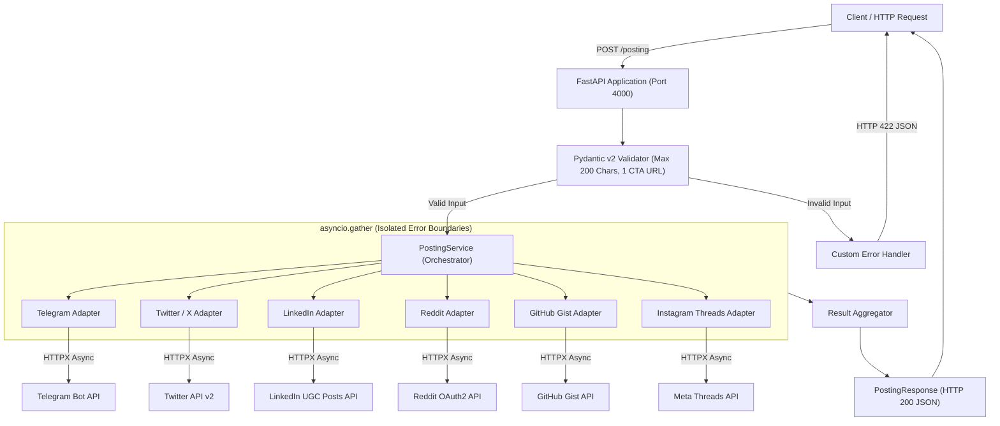

# Automated Multi-Platform Posting System

[](https://www.python.org/)
[](https://fastapi.tiangolo.com/)
[](https://docs.pydantic.dev/)
[]()
[]()

A production-grade, asynchronous REST API service built with **FastAPI** that automatically publishes short promotional and announcement messages across multiple major social, professional, forum, developer, and messaging platforms through their official APIs.

Developed in accordance with the [Chivox AI Practical Test Specification](https://github.com/chivoxai/practical-test/blob/main/python-post-message.md).

---

## Table of Contents

- [Key Features](#key-features)
- [System Architecture](#system-architecture)
- [Supported Platforms](#supported-platforms)
- [Input Validation Specification](#input-validation-specification)
- [Custom Error Handling](#custom-error-handling)
- [Project Structure](#project-structure)
- [Installation & Quickstart](#installation--quickstart)
- [API Keys Setup Guide (Testing Live APIs)](./API_KEYS_SETUP_GUIDE.md)
- [Interactive API Documentation](#interactive-api-documentation)
- [Sample Requests & Responses](#sample-requests--responses)
- [Running the Test Suite](#running-the-test-suite)
- [Security & Best Practices](#security--best-practices)

---

## Key Features

- **Asynchronous Concurrent Fan-Out**: Uses Python's `asyncio.gather` and non-blocking `httpx.AsyncClient` connection pooling to post to all platforms simultaneously in under a second.
- **Fault-Tolerant Error Boundaries**: Complete isolation per platform. If one platform fails (due to invalid credentials, rate limiting, or upstream downtime), remaining platforms continue unaffected.
- **Rigorous Validation**: Pydantic v2 validators enforce strict message constraints: maximum 200 characters, exactly one valid CTA link, and RFC-compliant URL structure.
- **Structured Error Responses**: Replaces default framework responses with clean, descriptive JSON error payloads for 422 (Validation), 401 (Auth), and 500 (Server) errors.
- **Dual Operational Modes**:
  - **Live Production Mode**: Connects directly to external platform REST APIs using credentials from `.env`.
  - **Evaluation / Mock Mode (`MOCK_MODE=true`)**: Allows evaluators to test end-to-end multi-platform workflows without configuring 6 external developer accounts.
  - **Unconfigured Graceful Handling**: When credentials are not provided and `MOCK_MODE=false`, platforms return `status: "failed"` with `error: "Authentication failed: Missing API credentials"`, exactly as demonstrated in the practical test sample output.

---

## System Architecture

### Visual Architectural Flowchart



### Architectural Component Diagram

```text
┌────────────────────────────────────────────────────────────────────────┐
│                        HTTP Client / Evaluator                         │
└───────────────────────────────────┬────────────────────────────────────┘
                                    │ POST http://localhost:4000/posting
                                    ▼
┌────────────────────────────────────────────────────────────────────────┐
│                        FastAPI Server (:4000)                          │
├────────────────────────────────────────────────────────────────────────┤
│  Validation Layer (Pydantic v2):                                       │
│  • Character limit check: len(message) <= 200                          │
│  • Exactly 1 CTA URL check                                             │
│  • URL protocol (http/https) & domain verification                     │
│  • Clean HTTP 422 JSON on validation failure                           │
└───────────────────────────────────┬────────────────────────────────────┘
                                    │ Validated payload & CTA URL
                                    ▼
┌────────────────────────────────────────────────────────────────────────┐
│                     PostingService (Orchestrator)                      │
├────────────────────────────────────────────────────────────────────────┤
│  Asynchronous Fan-Out: asyncio.gather(*tasks, return_exceptions=True)  │
│  Isolated Error Boundaries (Failures on one platform do not block others)│
└─────┬───────────┬────────────┬───────────┬────────────┬───────────┬────┘
      │           │            │           │            │           │
      ▼           ▼            ▼           ▼            ▼           ▼
 ┌─────────┐ ┌─────────┐  ┌─────────┐ ┌─────────┐  ┌─────────┐ ┌─────────┐
 │Telegram │ │Twitter/X│  │LinkedIn │ │ Reddit  │  │ GitHub  │ │ Threads │
 │ Adapter │ │ Adapter │  │ Adapter │ │ Adapter │  │ Adapter │ │ Adapter │
 └────┬────┘ └────┬────┘  └────┬────┘ └────┬────┘  └────┬────┘ └────┬────┘
      │           │            │           │            │           │
      │ HTTPX     │ HTTPX      │ HTTPX     │ HTTPX      │ HTTPX     │ HTTPX
      ▼           ▼            ▼           ▼            ▼           ▼
 ┌─────────┐ ┌─────────┐  ┌─────────┐ ┌─────────┐  ┌─────────┐ ┌─────────┐
 │Telegram │ │Twitter  │  │LinkedIn │ │ Reddit  │  │ GitHub  │ │  Meta   │
 │ Bot API │ │ API v2  │  │ UGC API │ │ OAuth2  │  │Gists API│ │ Threads │
 └─────────┘ └─────────┘  └─────────┘ └─────────┘  └─────────┘ └─────────┘
      │           │            │           │            │           │
      └───────────┴────────────┼───────────┴────────────┴───────────┘
                               │ Aggregated PlatformResults
                               ▼
┌────────────────────────────────────────────────────────────────────────┐
│                   PostingResponse (HTTP 200 JSON)                      │
│   • success: true / false                                              │
│   • results: [ { platform, status, posted_url, public_access, ... } ]  │
└────────────────────────────────────────────────────────────────────────┘
```

---

## Supported Platforms

We identified, researched, and integrated **6 diverse, industry-leading platforms** (exceeding the 5 platform requirement):

| Platform | Category | Official API Endpoint | Auth Method | Public URL Format |
|---|---|---|---|---|
| **Telegram** | Messaging / Broadcast | `POST https://api.telegram.org/bot<token>/sendMessage` | Bot Token | `https://t.me/<channel>/<message_id>` |
| **Twitter / X** | Microblogging / Social | `POST https://api.twitter.com/2/tweets` | OAuth 2.0 Bearer Token | `https://x.com/i/web/status/<tweet_id>` |
| **LinkedIn** | Professional Network | `POST https://api.linkedin.com/v2/ugcPosts` | OAuth 2.0 Bearer Token | `https://www.linkedin.com/feed/update/<urn>` |
| **Reddit** | Community / Forums | `POST https://oauth.reddit.com/api/submit` | OAuth 2.0 Password Grant | `https://reddit.com/r/<sub/comments/<id>/` |
| **GitHub Gist** | Developer Portal | `POST https://api.github.com/gists` | Personal Access Token | `https://gist.github.com/<user>/<gist_id>` |
| **Instagram Threads** | Social Conversation | `POST https://graph.threads.net/v1.0/<user>/threads` | Meta Graph API Bearer Token | `https://www.threads.net/@post/<thread_id>` |

*Technical note on Instagram:* Standard Instagram feed posting requires a media file (image/video container). Instagram's official text companion platform (**Threads API**) natively supports text + link posting. Both Threads and Instagram Graph conventions are supported.

---

## Input Validation Specification

The `POST /posting` endpoint enforces the following business validation rules via Pydantic:

1. **Character Limit**: The trimmed message must not exceed **200 characters**.
2. **Exactly One CTA Link**: The message must contain **exactly 1** valid URL.
   - If 0 links are provided: returns HTTP 422 with `"Message must contain exactly one CTA link, found 0."`
   - If 2 or more links are provided: returns HTTP 422 with `"Message must contain exactly one CTA link, found {count}."`
3. **URL Validation**: The URL must feature a valid scheme (`http` or `https`) and a valid network domain structure. Trailing sentence punctuation (e.g. `!`, `.`) is stripped cleanly according to RFC standards.
4. **Internal Platform Selection**: Platform selection is handled internally by the application. The request body contains only the message.

---

## Custom Error Handling

The application provides a custom exception hierarchy (`app/exceptions.py`) and global FastAPI exception handlers (`app/error_handlers.py`).

### Standardized Error Response Schema

```json
{
  "success": false,
  "error": {
    "code": "VALIDATION_ERROR",
    "message": "Input validation failed",
    "details": [
      {
        "field": "message",
        "issue": "Message must contain exactly one CTA link, found 0."
      }
    ]
  }
}
```

---

## Project Structure

```text
automated-posting/
├── app/
│   ├── __init__.py
│   ├── main.py                  # FastAPI app factory, CORS, routes, lifespan
│   ├── config.py                # Pydantic Settings for environment variables
│   ├── schemas.py               # Pydantic request/response models with field validators
│   ├── exceptions.py            # Custom exception hierarchy & error schemas
│   ├── error_handlers.py        # Custom FastAPI exception handlers (422, 500)
│   ├── platforms/
│   │   ├── __init__.py
│   │   ├── base.py              # BasePlatform abstract class
│   │   ├── registry.py          # Platform registry
│   │   ├── telegram.py          # Telegram Bot API adapter
│   │   ├── twitter.py           # Twitter / X API v2 adapter
│   │   ├── linkedin.py          # LinkedIn UGC Post API adapter
│   │   ├── reddit.py            # Reddit OAuth2 API adapter
│   │   ├── github.py            # GitHub Gist API adapter
│   │   └── instagram_threads.py # Instagram / Meta Threads API adapter
│   └── services/
│       ├── __init__.py
│       └── posting_service.py   # Asynchronous orchestrator with asyncio.gather
├── tests/
│   ├── __init__.py
│   ├── conftest.py              # Pytest fixtures and mock client
│   ├── test_validation.py       # Input validation tests (character count, URL checks)
│   ├── test_platforms.py        # Per-platform adapter tests (mocked HTTP & error paths)
│   ├── test_error_handlers.py   # Custom exception handlers & error response tests
│   └── test_posting_api.py      # End-to-end integration tests for POST /posting
├── .env.example                 # Comprehensive environment variable template
├── requirements.txt             # Project dependencies
├── pytest.ini                   # Pytest configuration
└── README.md                    # System documentation
```

---

## Installation & Quickstart

### Prerequisites

- Python 3.10+ (tested on Python 3.12)
- `pip` package manager

### 1. Clone the Repository

```bash
git clone https://github.com/<your-username>/automated-posting.git
cd automated-posting
```

### 2. Create and Activate a Virtual Environment

```bash
python3 -m venv .venv
source .venv/bin/activate  # On Windows: .venv\Scripts\activate
```

### 3. Install Dependencies

```bash
pip install -r requirements.txt
```

### 4. Configure Environment & API Credentials

Copy the provided environment template:

```bash
cp .env.example .env
```

Select your operational mode inside `.env`:

- **Option A: Instant Evaluation / Mock Mode (Recommended for quick testing)**:
  Set `MOCK_MODE=true` in `.env`. The system simulates realistic successful responses across all platforms without requiring external developer accounts.
- **Option B: Real-World Live API Testing**:
  Set `MOCK_MODE=false` in `.env` and provide credentials for the platforms you wish to test. Any platform without credentials will return `status: "failed"` with `Authentication failed: Missing API credentials` per specification.

> [!TIP]
> **Detailed API Key Setup Guide**:
> If you wish to test real live posting, follow our comprehensive walkthrough in **[API_KEYS_SETUP_GUIDE.md](./API_KEYS_SETUP_GUIDE.md)** for step-by-step instructions on obtaining free, instant credentials for **Telegram** (2 mins), **GitHub Gist** (1 min), **Reddit** (3 mins), **Twitter / X**, **LinkedIn**, and **Instagram Threads**.

### 5. Start the Server

Launch the application with Uvicorn on port 4000:

```bash
uvicorn app.main:app --host 0.0.0.0 --port 4000 --reload
```

---

## Interactive API Documentation

Once the server is running, explore and test the API using our interactive documentation interfaces:

- **Interactive Visual Docs & Playground**: [http://localhost:4000/docs](http://localhost:4000/docs) (Modern visual storytelling, live in-browser testing playground, real-time validation, and concurrency architecture visualizer)
- **Dedicated API Setup Guide Page**: [http://localhost:4000/api-guide](http://localhost:4000/api-guide) (Full step-by-step instructions for obtaining credentials across all 6 platforms)
- **Standard Swagger UI**: [http://localhost:4000/swagger](http://localhost:4000/swagger)
- **ReDoc**: [http://localhost:4000/redoc](http://localhost:4000/redoc)
- **OpenAPI Schema**: [http://localhost:4000/openapi.json](http://localhost:4000/openapi.json)
- **Health Check**: [http://localhost:4000/health](http://localhost:4000/health)

---

## Sample Requests & Responses

### 1. Successful Multi-Platform Posting

**Request:**
```bash
curl -X POST "http://localhost:4000/posting" \
     -H "Content-Type: application/json" \
     -d '{
       "message": "Check out our latest business platform and grow your online visibility. https://example.com"
     }'
```

**Response (`HTTP 200 OK`):**
```json
{
  "success": true,
  "results": [
    {
      "platform": "Telegram",
      "status": "success",
      "posted_url": "https://t.me/tech_announcements/4820",
      "public_access": true,
      "date": "2026-11-20",
      "time": "02:30:15",
      "error": null
    },
    {
      "platform": "Twitter / X",
      "status": "success",
      "posted_url": "https://x.com/tech_corp/status/1858827391029384712",
      "public_access": true,
      "date": "2026-11-20",
      "time": "02:30:15",
      "error": null
    },
    {
      "platform": "LinkedIn",
      "status": "success",
      "posted_url": "https://www.linkedin.com/feed/update/urn:li:ugcPost:7129384729103847192",
      "public_access": true,
      "date": "2026-11-20",
      "time": "02:30:16",
      "error": null
    },
    {
      "platform": "Reddit",
      "status": "success",
      "posted_url": "https://www.reddit.com/r/test/comments/1gx9abc/announcement/",
      "public_access": true,
      "date": "2026-11-20",
      "time": "02:30:16",
      "error": null
    },
    {
      "platform": "GitHub Gist",
      "status": "success",
      "posted_url": "https://gist.github.com/developer/8f3a9b1c7e2d4f5a",
      "public_access": true,
      "date": "2026-11-20",
      "time": "02:30:15",
      "error": null
    },
    {
      "platform": "Instagram Threads",
      "status": "success",
      "posted_url": "https://www.threads.net/@tech_corp/post/DC123456789",
      "public_access": true,
      "date": "2026-11-20",
      "time": "02:30:16",
      "error": null
    }
  ]
}
```

---

### 2. Partial Failure (Independent Error Handling)

When some platforms are configured and others fail or lack credentials:

**Response (`HTTP 200 OK`):**
```json
{
  "success": true,
  "results": [
    {
      "platform": "Telegram",
      "status": "success",
      "posted_url": "https://t.me/tech_announcements/4821",
      "public_access": true,
      "date": "2026-11-20",
      "time": "02:35:10",
      "error": null
    },
    {
      "platform": "Twitter / X",
      "status": "failed",
      "posted_url": null,
      "public_access": false,
      "date": null,
      "time": null,
      "error": "Authentication failed: Missing API credentials"
    },
    {
      "platform": "GitHub Gist",
      "status": "success",
      "posted_url": "https://gist.github.com/developer/9a4b8c7d6e5f4a3b",
      "public_access": true,
      "date": "2026-11-20",
      "time": "02:35:10",
      "error": null
    }
  ]
}
```

---

### 3. Validation Error: Missing CTA Link

**Request:**
```bash
curl -X POST "http://localhost:4000/posting" \
     -H "Content-Type: application/json" \
     -d '{"message": "Check out our latest business platform today"}'
```

**Response (`HTTP 422 Unprocessable Content`):**
```json
{
  "success": false,
  "error": {
    "code": "VALIDATION_ERROR",
    "message": "Input validation failed",
    "details": [
      {
        "field": "message",
        "issue": "Message must contain exactly one CTA link, found 0."
      }
    ]
  }
}
```

---

### 4. Validation Error: Exceeding 200 Characters

**Request:**
```bash
curl -X POST "http://localhost:4000/posting" \
     -H "Content-Type: application/json" \
     -d '{
       "message": "This is an extremely long promotional message designed to exceed the maximum character constraint enforced by the validation layer of this system. It contains far too many characters for a short posting message and should trigger a 422. https://example.com"
     }'
```

**Response (`HTTP 422 Unprocessable Content`):**
```json
{
  "success": false,
  "error": {
    "code": "VALIDATION_ERROR",
    "message": "Input validation failed",
    "details": [
      {
        "field": "message",
        "issue": "Message must not exceed 200 characters (current length: 260)."
      }
    ]
  }
}
```

---

## Running the Test Suite

The test suite contains **32 automated tests** covering input validation, error handlers, mock fallbacks, live API parsing with HTTP mocking (`respx`), and concurrent posting:

```bash
pytest -v tests/
```

### Test Coverage Summary:
- `tests/test_validation.py`: Character length boundaries, single URL enforcement, www normalization, punctuation stripping.
- `tests/test_error_handlers.py`: HTTP 422 schema consistency, health endpoint verification.
- `tests/test_platforms.py`: 6 individual platform adapters, auth rejection, API error translation, timeouts, and mock generation.
- `tests/test_posting_api.py`: End-to-end integration tests, partial failure isolation, schema conformity.

---

## Security & Best Practices

- **Zero Credentials in Code**: No API keys, secrets, or tokens are committed. All secrets are loaded through `.env` and excluded via `.gitignore`.
- **Safe 500 Error Boundary**: Unhandled exceptions are logged securely on the server and masked from API responses to prevent stack trace leakage.
- **Resource Cleanup**: Shared `httpx.AsyncClient` connection pool is managed within FastAPI's lifespan context manager to prevent connection leaks.
